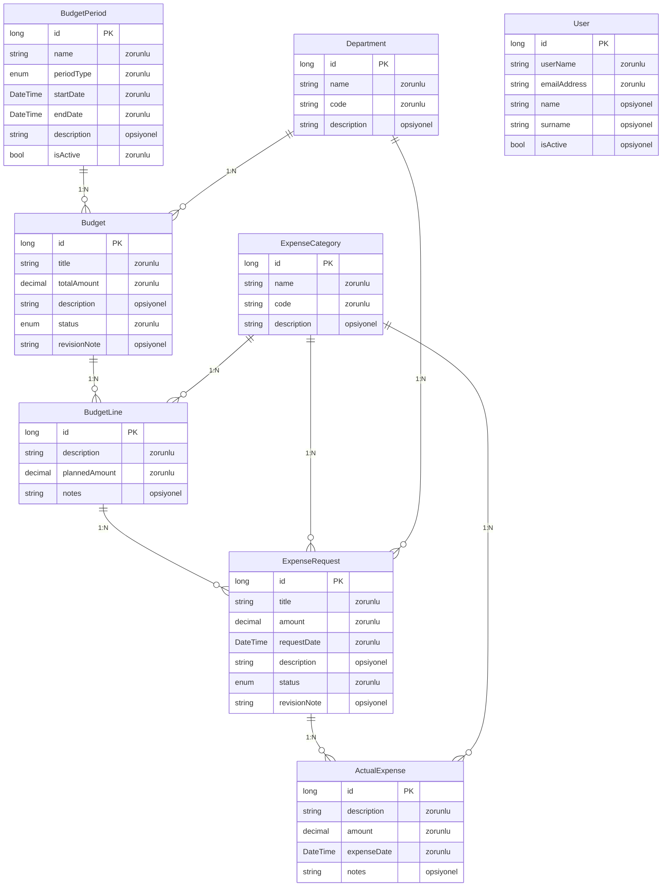
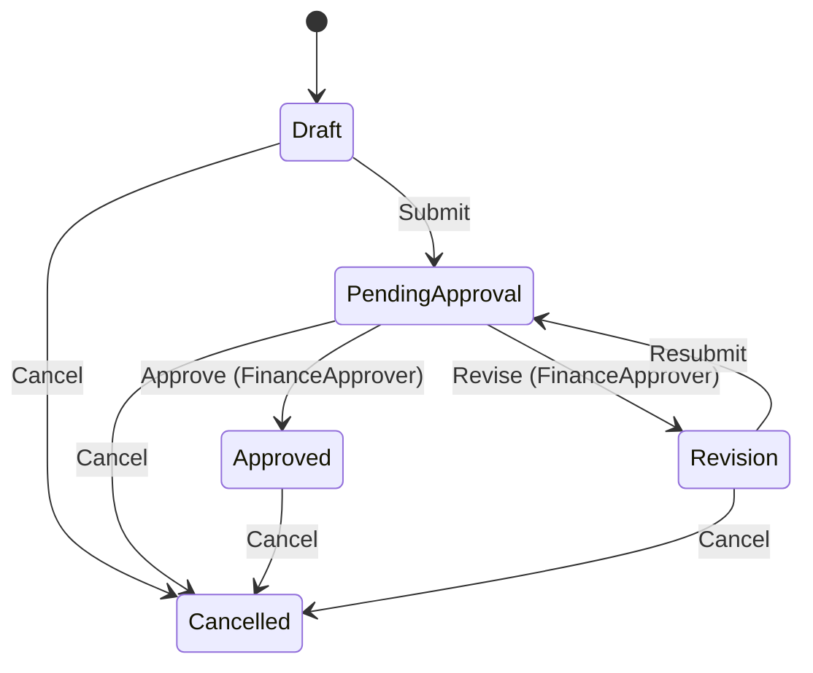
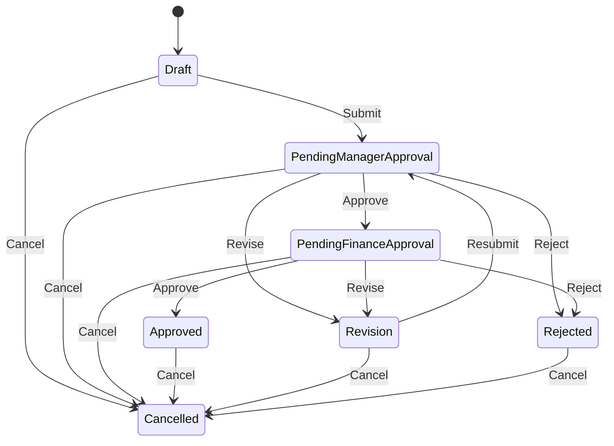
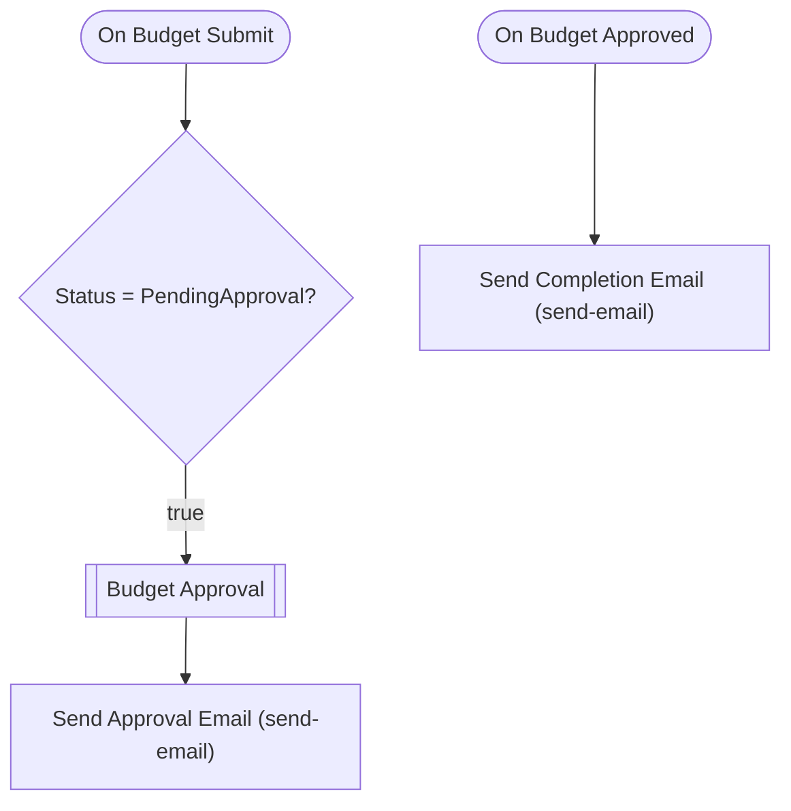
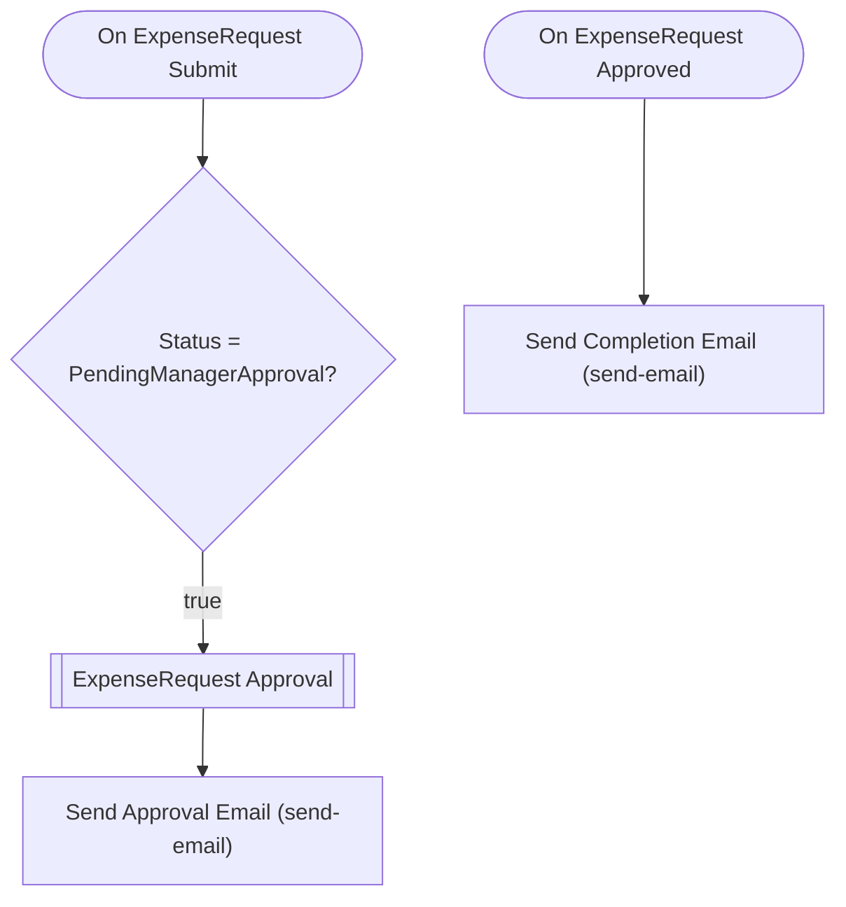

# budgetperiodapp — Talep Analizi

> Bu belge Archipid talep olgunlaştırma (discovery) akışıyla üretildi.

## Orijinal Talep

bütçe takibi için bir uygulama istiyorum

## Özet

Bu uygulama, departmanların bütçe planlamasını ve harcama taleplerini merkezi olarak yönetmesini sağlar. Bütçeler aylık veya yıllık dönemler ve departmanlar bazında oluşturulur; harcama talepleri ise yönetici ve finans onayından geçerek gerçekleşen harcamalarla eşleştirilir.

Bütçe sahibi önce aylık ya da yıllık dönem seçerek bütçeyi oluşturur ve kalemlerini girer; finans ekibi bütçeyi onaylar. Ardından çalışanlar onaylı bütçeye ait bir veya birden fazla kaleme bağlı harcama talepleri açar. Talep önce departman yöneticisine, sonra finans ekibine gider; her iki onay alınınca harcama gerçekleşmiş sayılır ve yetkili kullanıcı gerçekleşen harcama kaydını sisteme girer. Revize istenirse form talep eden kişiye geri döner, düzeltip tekrar gönderir.

## Kapsam

- (belirtilmedi)

## Kapsam Dışı

- (belirtilmedi)

## Açık Noktalar

- (belirtilmedi)

## Eksiklikler

- (belirtilmedi)

## Öneriler

- (belirtilmedi)

## Veri Modeli

### BudgetPeriod — Bütçe Dönemi

| Alan | Tip | Zorunlu | Uzunluk |
|---|---|---|---|
| `id` | long | Evet | — |
| `name` | string | Evet | 200 |
| `periodType` | enum (Monthly,Annual) | Evet | — |
| `startDate` | DateTime | Evet | — |
| `endDate` | DateTime | Evet | — |
| `description` | string | Hayır | 1000 |
| `isActive` | bool | Evet | — |

**Neye bağlı:** Budget (1:N, bu tablo "bir" tarafı)

### Department — Departman

| Alan | Tip | Zorunlu | Uzunluk |
|---|---|---|---|
| `id` | long | Evet | — |
| `name` | string | Evet | 200 |
| `code` | string | Evet | 50 |
| `description` | string | Hayır | 1000 |

**Neye bağlı:** Budget (1:N, bu tablo "bir" tarafı) · ExpenseRequest (1:N, bu tablo "bir" tarafı)

### ExpenseCategory — Harcama Kategorisi

| Alan | Tip | Zorunlu | Uzunluk |
|---|---|---|---|
| `id` | long | Evet | — |
| `name` | string | Evet | 200 |
| `code` | string | Evet | 50 |
| `description` | string | Hayır | 1000 |

**Neye bağlı:** BudgetLine (1:N, bu tablo "bir" tarafı) · ExpenseRequest (1:N, bu tablo "bir" tarafı) · ActualExpense (1:N, bu tablo "bir" tarafı)

### Budget — Bütçe

| Alan | Tip | Zorunlu | Uzunluk |
|---|---|---|---|
| `id` | long | Evet | — |
| `title` | string | Evet | 200 |
| `totalAmount` | decimal | Evet | — |
| `description` | string | Hayır | 1000 |
| `status` | enum (Draft,PendingApproval,Approved,Revision,Cancelled) | Evet | — |
| `revisionNote` | string | Hayır | 1000 |

**Neye bağlı:** BudgetPeriod (1:N, bu tablo "çok" tarafı) · Department (1:N, bu tablo "çok" tarafı) · BudgetLine (1:N, bu tablo "bir" tarafı)

### BudgetLine — Bütçe Kalemi

| Alan | Tip | Zorunlu | Uzunluk |
|---|---|---|---|
| `id` | long | Evet | — |
| `description` | string | Evet | 500 |
| `plannedAmount` | decimal | Evet | — |
| `notes` | string | Hayır | 1000 |

**Neye bağlı:** Budget (1:N, bu tablo "çok" tarafı) · ExpenseCategory (1:N, bu tablo "çok" tarafı) · ExpenseRequest (1:N, bu tablo "bir" tarafı)

### ExpenseRequest — Harcama Talebi

| Alan | Tip | Zorunlu | Uzunluk |
|---|---|---|---|
| `id` | long | Evet | — |
| `title` | string | Evet | 200 |
| `amount` | decimal | Evet | — |
| `requestDate` | DateTime | Evet | — |
| `description` | string | Hayır | 1000 |
| `status` | enum (Draft,PendingManagerApproval,PendingFinanceApproval,Approved,Revision,Rejected,Cancelled) | Evet | — |
| `revisionNote` | string | Hayır | 1000 |

**Neye bağlı:** BudgetLine (1:N, bu tablo "çok" tarafı) · ExpenseCategory (1:N, bu tablo "çok" tarafı) · Department (1:N, bu tablo "çok" tarafı) · ActualExpense (1:N, bu tablo "bir" tarafı)

### ActualExpense — Gerçekleşen Harcama

| Alan | Tip | Zorunlu | Uzunluk |
|---|---|---|---|
| `id` | long | Evet | — |
| `description` | string | Evet | 500 |
| `amount` | decimal | Evet | — |
| `expenseDate` | DateTime | Evet | — |
| `notes` | string | Hayır | 1000 |

**Neye bağlı:** ExpenseRequest (1:N, bu tablo "çok" tarafı) · ExpenseCategory (1:N, bu tablo "çok" tarafı)

### User — Kullanıcı (Sistem)

| Alan | Tip | Zorunlu | Uzunluk |
|---|---|---|---|
| `id` | long | Evet | — |
| `userName` | string | Evet | 64 |
| `emailAddress` | string | Evet | 256 |
| `name` | string | Hayır | 128 |
| `surname` | string | Hayır | 128 |
| `isActive` | bool | Hayır | — |

**Neye bağlı:** bağımsız tablo

## İş Akışları

### Bütçe — durum makinesi

**Onay adımları**

| # | Adım | Atanan | Aksiyonlar | Zorunlu alanlar |
|---|---|---|---|---|
| 1 | Finans Onayı | Rol: `FinanceApprover` | Onayla (approve), Revize Et (revise) | `revisionNote` |

Reddedilirse kayıt **`Revision`** durumuna döner.

### Harcama Talebi — durum makinesi

**Onay adımları**

| # | Adım | Atanan | Aksiyonlar | Zorunlu alanlar |
|---|---|---|---|---|
| 1 | Yönetici Onayı | Rol: `DepartmentManager` | Onayla (approve), Revize Et (revise) | `revisionNote` |
| 2 | Finans Onayı | Rol: `FinanceApprover` | Onayla (approve), Revize Et (revise) | `revisionNote` |

Reddedilirse kayıt **`Revision`** durumuna döner.

### Akış: Budget Approval Flow

Auto-generated approval flow for Budget. Customize email templates and add conditions as needed.

### Akış: ExpenseRequest Approval Flow

Auto-generated approval flow for ExpenseRequest. Customize email templates and add conditions as needed.

## Elle Geliştirme Gerektirenler

Aşağıdaki maddeler senaryonun gereği ama üretilen koda yansımıyor — kod yazılması gerekir.

| Alan | İş | Neden | Geçici çözüm |
|---|---|---|---|
| flow | Harcama talebi onaylanınca ActualExpense otomatik oluşturma | Onay tamamlandığında bir başka entity'nin kaydını otomatik oluşturan akış üretilemiyor; kayıt oluşturma yalnızca kullanıcı eylemiyle tetiklenir. | Finans onayı tamamlandıktan sonra yetkili kullanıcı ActualExpense kaydını manuel olarak girer. ActualExpense, ExpenseRequest'e bağlı olduğundan ilişki eksiksiz kurulur. |
| entity | Toplam harcama / kalan bütçe hesabı | BudgetLine.plannedAmount ile bağlı ActualExpense kayıtlarının toplamı hesaplanmaz; hesaplanan alan üretilmiyor. | Raporlama ekranında toplam ve kalan bütçe görülmek isteniyorsa bu hesaplama özel bir rapor sorgusu ile elle geliştirilmeli. |
| validation | Harcama talebi tutarının bütçe kalemini aşması engeli | Harcama talebi kaydedilirken ilgili BudgetLine.plannedAmount ile karşılaştırma yapan iş kuralı üretilmiyor. | Bütçe aşımı kontrolü özel validation ile elle eklenmeli; şimdilik kullanıcı girebilir, rapordan izlenir. |
